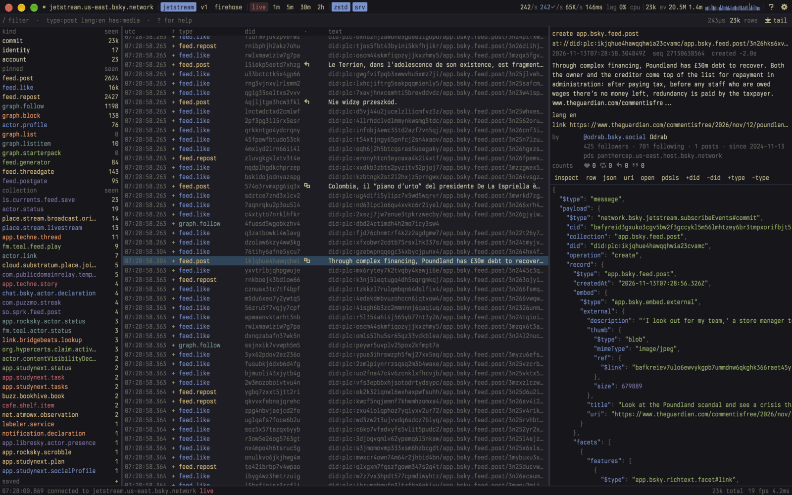
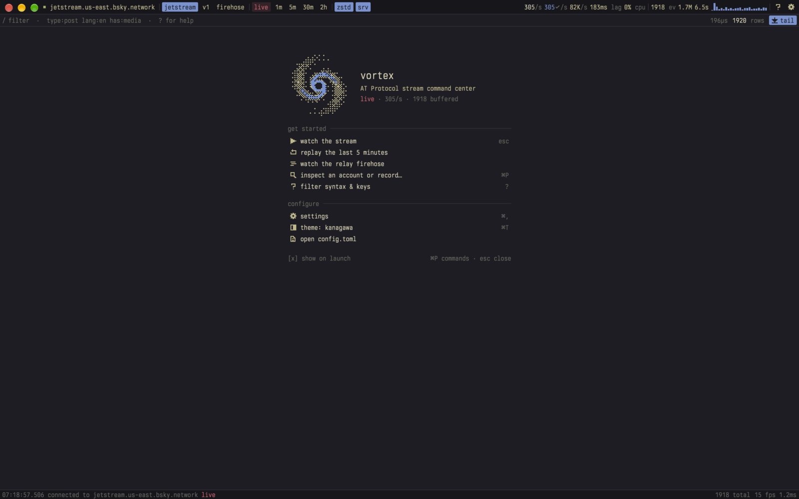
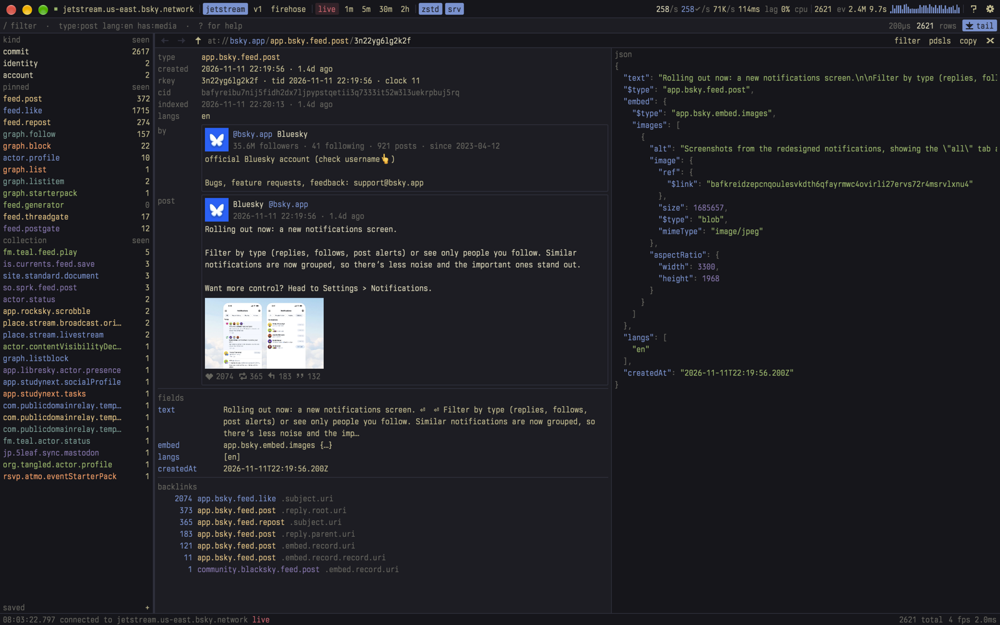
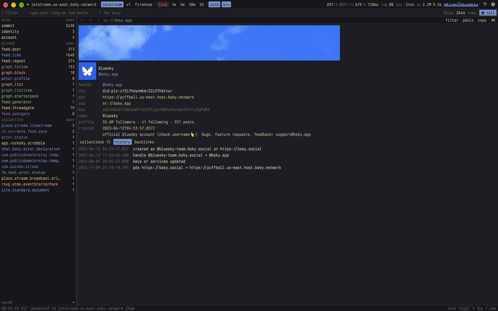
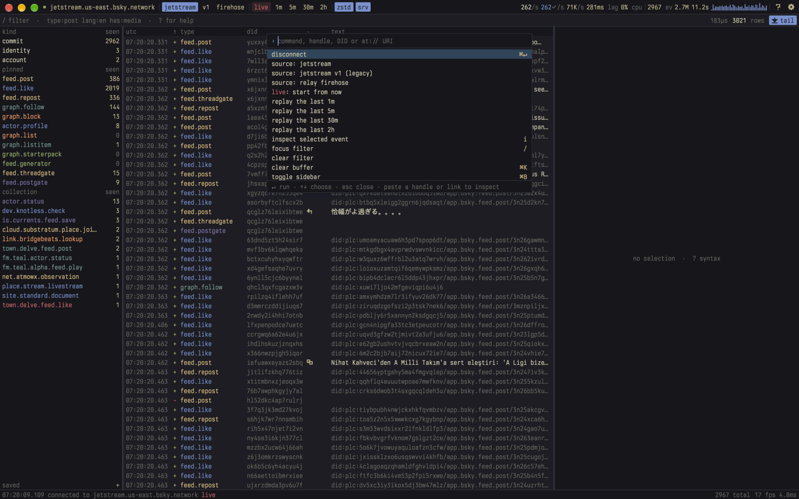

# vortex

A fast, information-dense desktop command center for the AT Protocol: watch
Bluesky's Jetstream or the relay firehose live, filter it with a real query
language, and inspect any account or record the way
[pdsls](https://pdsls.dev) does. Rust and [GPUI](https://gpui.rs).



- **Every source, one model.** Jetstream (v2 and legacy) and the raw relay
  firehose (DAG-CBOR and CAR, decoded locally) all become the same events,
  so every filter works everywhere.
- **Filters that scale.** About 40 fields, regex, JSON paths, counts, time
  ranges and sampling, compiled to an optimised matcher (5–35 ns per event)
  and pushed to the server where possible. Changing a query re-filters
  everything already buffered.
- **Context on demand.** Selecting an event fetches the author, the post it
  likes or replies to, and live counts. One key opens an inspector for the
  repo, its collections, PLC history and backlinks.
- **Built to stay out of the way.** Compact, keyboard-first, themeable, and
  cheap to leave running: about 10% of one core while tailing the full
  network, less when filtered.

## Contents

- [Quick start](#quick-start)
- [A tour](#a-tour)
- [Filter language](#filter-language)
- [Keys](#keys)
- [Configuration](#configuration)
- [Headless tools](#headless-tools)
- [How it works](#how-it-works)
- [Development](#development)

## Quick start

```sh
cargo run --release -p vortex
```

vortex is developed and tested on macOS (Apple Silicon) with a recent Rust
toolchain (currently 1.98 nightly; the workspace uses edition 2021). GPUI's
Linux backends are compiled in, but vortex has not been tested on Linux.

On first launch vortex connects to Jetstream and opens the welcome screen.
Press `esc` to go to the event list, `⌘P` to find any command, or `?` for
the filter syntax and keys. Settings live in `~/.config/vortex/config.toml`
and can be edited while the app runs.

## A tour

### Welcome



Common starting points: watch the stream, replay the last five minutes,
switch to the relay firehose, or inspect an account. Turn it off with the
"show on launch" checkbox, or **welcome on launch** in settings.

### The stream

The **top bar** is the connection (click to connect or disconnect), the
source (`jetstream`, `v1`, `firehose`), where to start (`live`, or replay the
last `1m` `5m` `30m` `2h`), and the `zstd` and `srv` (server filter)
switches. On the right are events/s received and matching, bandwidth, lag,
pipeline load, the buffer (events, memory, time span) and a rate sparkline.
Hover any of them for an explanation.

The **sidebar** counts the buffer by kind and collection. With a filter
active it shows both matching and seen counts. Click to add a term to the
query, alt-click to exclude it, right-click a collection to pin or unpin it.
Pinned collections stay at the top in a fixed order.

The **list** shows time, operation (`+` create, `~` update, `-` delete, `@`
identity, `!` account), type, author, marks (reply, quote, images, video,
link, labeled) and text. Tail mode (`space`) follows new events. Scrolling
up pauses it, and `r` jumps back to the selected row.

The **detail pane** shows the event and its raw JSON. A post's mentions,
links and hashtags are highlighted: click to inspect the account, open the
link, or filter by the tag. Once the selection settles it also looks up
context: the author's profile, follower counts and PDS, and the post being
liked, reposted, replied to or quoted, shown as a card with its author,
text, media, its own quote and its counts. Followed or blocked accounts
get a profile card. Click any of them to inspect it. Double-click a row
(or press `i`) to open the event in the inspector.

### Media and labels

Posts show their images, video thumbnails, GIFs and link cards in the detail
pane and the inspector, with avatars next to every looked-up account and the
banner on a repo page. Profiles, lists, feed generators and labelers show
their avatars and banners; records from other lexicons list their blobs.
Click a tile to open the viewer: `←` `→` (or `h` `l`) step through, `space`
pauses video, `m` mutes, `o` opens the original, `esc` closes. Hover a tile
for its alt text.

Content labels are shown before the media they apply to: self-labels from
the record, plus labeler labels from the AppView, each naming the labeler
that applied it. Media under adult, graphic or warning labels stays behind a
"click to show" placeholder until you reveal it, and isn't downloaded until
then. Events carrying labels get a warning mark in the list. **media** and
**labeled media** in settings turn loading off or show labeled media
directly.

Images come from the Bluesky CDN, video thumbnails and HLS playback from
`video.bsky.app`, and anything else straight from the account's PDS.
Video playback uses GStreamer (see [Development](#development)).

### Inspector



Press `i` on an event (or double-click it), click a looked-up account or
post, or paste anything into `⌘P`: a handle, DID, `at://` URI, bsky.app
link or pdsls link.

- **Repos** show banner, avatar, handle, DID, PDS, aliases, signing key and
  profile, with tabs for collections, PLC history and backlinks. History is
  summarised as changes, such as "handle @a → @b" or a PDS migration.
- **Collections** list records 100 at a time, with "load more".
- **Records** are split. On the left is everything that can be read from
  the record: type, creation time, the time encoded in a TID record key,
  CID and when the AppView indexed it. Then the author, what the record
  points at (the post replied to and the thread root, the liked or
  reposted post, the followed account, the list), and the record itself:
  a post as a card with its text, media, quote and counts, or another
  record's media and description. After that comes every field summarised
  on one line, which works for any lexicon, and backlinks from
  [constellation](https://constellation.microcosm.blue). On the right is
  the JSON; any line holding an `at://` URI or DID is a link.

`⌘[` `⌘]` go back and forward, `⌘↑` goes up a level, the breadcrumbs are
clickable, and `esc` returns to the stream. **filter** limits the stream to
that account, and **pdsls** opens the same page on pdsls.dev.



Lookups are read-only and go to the public AppView (`public.api.bsky.app`),
`plc.directory`, the account's own PDS, and constellation. Results are cached
for the session.

### Command palette and menus



`⌘P` lists every command: connect, sources, replay, panes, toggles, themes,
saved filters, settings and config. Type to narrow the list. Paste a handle,
DID or link and the first entry inspects it. The same commands are in the
macOS menu bar, which shows each one's shortcut.

## Filter language

Type in the filter bar (`/`). Terms are ANDed; `OR`, `-term` or `NOT`, and
parentheses work as usual. Errors are underlined as you type. Field names and
their values autocomplete: `tab` inserts and `↑` `↓` choose, and the
suggestions include collections seen in the stream.

```
type:post lang:en has:media -is:reply
"exact phrase" OR #rustlang OR domain:github.com
type:like subject:did:plc:z72i7hdynmk6r22z27h6tvur
kind:account status:takendown,suspended
type:post text~\bcats?\b len>200 images>=2
record.embed.$type:video        record.facets[*].features[*].tag:art
did:@~/watchlist.txt            sample:5%
```

| field | meaning |
| --- | --- |
| `word` `"a phrase"` | text contains (case-insensitive) |
| `text:` `name:` `alt:` | post text / display name / image alt |
| `type:` `collection:` | `post like repost follow block profile …` or an NSID; globs ok |
| `did:` `from:` | author DID; `did:@/path/file` loads a list |
| `kind:` `op:` | `commit identity account sync` / `create update delete` |
| `lang:` `tag:` `#tag` | language (`en` matches `en-US`) / hashtag |
| `mention:` `link:` `domain:` | mentioned DID / link URL / link host (subdomains match) |
| `has:` `is:` `embed:` | `reply quote media image video link mention tag label alt gif root …` |
| `reply-to:` `root:` `quote:` `subject:` | referenced AT-URI contains (a DID works) |
| `handle:` `status:` `active:` | identity / account event fields |
| `len images tags mentions links langs bytes` | counts: `len>200` `images:2` `tags:1..3` |
| `time created skew` | `time>2026-01-01T00:00Z` `skew>1h` (createdAt vs. event time) |
| `record.path` `json.path` | any JSON field, with `[n]`, `[*]`, `*` |
| `exists:` `raw:` `uri:` `rkey:` `label:` `word:` | path exists / raw frame contains / … |
| `sample:` | keep a deterministic fraction: `sample:10%` |

Operators: `:` match · `=` exact · `~` regex · `!=` `!~` negated · `>` `>=`
`<` `<=` numeric · `a,b` any of · `/re/flags` regex literal · `*` glob.

**Changing the filter re-filters everything already buffered**, not just new
events. With `srv` on, the part of the query the server can evaluate (kinds,
collections, DIDs) is sent to Jetstream, so a narrow query costs almost no
bandwidth. Turn it off to keep the whole stream buffered for later queries.
`+` in the sidebar saves the current query.

## Keys

| keys | action |
| --- | --- |
| `/` `⌘F` `⌘L` | focus the filter (`enter` applies, `tab` completes, `esc` leaves) |
| `j` `k` `↑` `↓` | move the selection |
| `g` `G` `home` `end` `pgup` `pgdn` `ctrl-u` `ctrl-d` | jump, page |
| `space` `f` | tail on/off |
| `r` | scroll back to the selected row |
| `i`, double-click | inspect the selected record or repo |
| `c` `u` | copy event JSON / AT-URI |
| `o` `↵` | open on bsky.app (pdsls for other records) |
| `p` | open on pdsls.dev |
| `esc` | close help, settings, inspector or welcome; then deselect |
| `←` `→` `space` `m` `o` | media viewer: step, pause, mute, open original |
| `⌘P` `⌘⇧P` | command palette |
| `⌘[` `⌘]` `⌘↑` | inspector back / forward / up |
| `⌘↵` | connect / disconnect |
| `⌘K` | clear the buffer |
| `⌘B` `⌘I` | toggle sidebar / detail pane |
| `⌘T` `⌘⇧T` | next / previous theme (right-click the welcome theme row too) |
| `⌘=` `⌘-` | font size |
| `⌘,` `?` | settings / filter syntax and keys |
| `⌘H` `⌥⌘H` `⌘M` `⌃⌘F` `⌘Q` | hide, hide others, minimise, full screen, quit |

## Configuration

`~/.config/vortex/config.toml`, or `$XDG_CONFIG_HOME/vortex/config.toml`.
Edits are picked up while the app runs, and changes made in the UI are
written back. A file with a syntax error is reported in the status bar and
never overwritten. Every key is optional; these are the defaults.

```toml
[ui]
theme = "kanagawa"         # gruvbox-dark gruvbox-light catppuccin-mocha tokyo-night
                           # nord dracula solarized-dark one-dark bloomberg
font = "Berkeley Mono"     # any installed family
font_size = 12.0
line_height = 1.4
padding = 4.0
radius = 2.0
square_corners = false     # macOS: square window corners
fps_meter = true           # frames/s and CPU time per frame in the status bar
welcome = true             # welcome screen on launch
sidebar = true
sidebar_width = 220.0
detail = true
detail_width = 440.0

[source]
kind = "jetstream"         # jetstream | jetstream-v1 | firehose
hosts = []                 # empty = public defaults; "ws://localhost:6008" works
compress = true            # zstd
pushdown = true            # send the server-side part of the query
autoconnect = true

[filter]
query = ""                 # restored on launch
pinned = [                 # sidebar order
  "app.bsky.feed.post", "app.bsky.feed.like", "app.bsky.feed.repost",
  "app.bsky.graph.follow", "app.bsky.graph.block", "app.bsky.actor.profile",
  "app.bsky.graph.list", "app.bsky.graph.listitem", "app.bsky.graph.starterpack",
  "app.bsky.feed.generator", "app.bsky.feed.threadgate", "app.bsky.feed.postgate",
]

[media]
load = true                # fetch images, avatars and video thumbnails
reveal_labeled = false     # show media under adult/graphic labels without a click

[buffer]
events = 300000            # kept for instant re-filtering
megabytes = 512
pinned = 100000            # matches kept after they age out of the buffer
```

Colors, themes and saved queries have no defaults to show; add them like
this:

```toml
[colors]                   # override any slot of the active theme
accent = "#ff8800"

[themes.midnight]          # define your own, then set ui.theme = "midnight"
base = "nord"
bg = "#0b0e14"

[[filter.saved]]           # one block per saved query (the sidebar's + adds these)
name = "japanese art"
query = "type:post lang:ja tag:art"
```

Color slots: `bg bg_alt bg_hover bg_sel border fg fg_dim fg_faint accent red
green yellow blue purple aqua orange`. Most `[ui]` settings are also in the
settings panel (`⌘,`).

## Headless tools

```sh
# Stream to the terminal with the same filter language
cargo run --release --bin vortex-tail -- 'type:post lang:ja has:media'
#   [--source jetstream|jetstream-v1|firehose] [--host H] [--rewind 5m]
#   [--cursor N] [--no-compress] [--no-pushdown] [--secs N] [--print N] [--json]

# Stage timings on live Jetstream traffic
cargo run --release --bin vortex-bench

# Record relay frames once, then benchmark firehose decoding offline
cargo run --release --bin vortex-bench-firehose -- capture target/firehose.capture
cargo run --release --bin vortex-bench-firehose -- bench target/firehose.capture
```

## How it works

```
 net thread (tokio, current-thread)          pipeline thread (+ rayon on bursts)
 ┌────────────────────────────────┐  frames  ┌────────────────────────────────┐
 │ websocket · reconnect · resume ├─────────▶│ zstd · decode · dedup · filter │
 └────────────────▲───────────────┘ bounded  └────────────────┬───────────────┘
                  │ commands                                  │ batches
            ┌─────┴────┐                                 ┌────▼────┐
            │  Engine  │◀───────────── UI ──────────────▶│  Store  │
            └──────────┘    (never blocks on either)     └─────────┘
```

- **`crates/core`** has no UI dependency and is fully testable headless.
- **Network** only moves bytes. Connections reconnect with jittered backoff,
  resume from the last processed cursor, and fail over between hosts. Frames
  cross a bounded channel, so a slow consumer back-pressures the socket
  instead of growing memory.
- **Pipeline** drains the channel in adaptive batches: a few frames at
  live-tail rates (one thread hop of latency), thousands during replay, where
  decode fans out over rayon with order preserved. The store lock is taken
  once per batch and the filter runs outside it.
- **Events** are a fixed 168-byte header plus one allocation holding the raw
  JSON and every extracted field. `did:plc` identifiers are packed to 15
  bytes; collections are interned pointers. Filters read pre-extracted data,
  and nothing is re-parsed unless a JSON-path predicate asks.
- **Decoding** uses a purpose-built zero-allocation JSON pull scanner. The
  firehose path transcodes DAG-CBOR and CAR into the Jetstream JSON shape in
  one byte-oriented pass, so there is exactly one extraction path.
- **Filters** compile to a small tree that is optimised before use: OR'd text
  literals merge into one Aho-Corasick automaton, DID lists into a hash set,
  kind and flag tests into single mask checks, and children are ordered
  cheapest first.
- **Store** keeps every recent event (so a new filter applies to history, in
  parallel) plus matches that have aged out of that window.
- **UI** checks version counters at 30 Hz and redraws only when what is on
  screen changed. A narrow filter that matched nothing new costs nothing, and
  nothing redraws behind the welcome screen or inspector. Rendering never
  waits on the store: if ingest holds it, the previous frame's rows are
  reused. Text is cut to the visible column width before shaping, and long
  inspector pages are virtualised.
- **Lookups** (`crates/app/src/atp.rs`) are a small read-only AT Protocol
  client on background threads, with a session cache.

### Numbers

`vortex-bench` on live Jetstream traffic (Apple Silicon, one thread unless
noted):

| stage | cost |
| --- | --- |
| zstd inflate | ~0.7 µs/event |
| decode + extract | ~0.7 µs/event (≈1.4 M events/s, ≈1 GB/s of JSON) |
| typical filters | 5–35 ns/event |
| JSON-path filter | ~200 ns/event |
| re-filter 140k buffered events (parallel) | 0.4–6 ms |
| 10 min replay (214k events) end to end | ~2.5 s, network-bound |

`vortex-bench-firehose` on 150k captured relay frames (5.5 KB per frame,
Apple Silicon, one thread):

| stage | cost |
| --- | --- |
| firehose frame → events, end to end | ~1.0 µs/event (≈1 M events/s, ≈5 GB/s of wire) |
| same, frames cold in memory | ~1.6 µs/event |
| CBOR envelope + CAR walk | ~0.25 µs/event |
| record CBOR → JSON | ~0.14 µs/event (≈1.9 GB/s) |
| JSON extract + event build | ~0.41 µs/event |

The live network is a few hundred events per second; the headroom is for
replay and for re-filtering large buffers interactively. The app itself
(release build, full network, list tailing) uses about 10% of one core.

## Development

```
crates/core   vortex-core: decode, filter, store, pipeline, net (no UI)
crates/app    vortex: GPUI app (ui/, atp.rs lookups, media.rs, config, themes)
crates/video  gpui-video-player, vendored for gpui-pre (GStreamer playback)
assets/       zstd dictionaries, bundled font
docs/         screenshots
```

```sh
cargo test --workspace                                # unit, property and differential tests
cargo test -p vortex -- --ignored live_lookups        # hits the real AppView/PLC/PDS/constellation
VORTEX_FIREHOSE_CAPTURE=target/firehose.capture \
  cargo test --release -p vortex-core differential_capture   # new vs. reference firehose decoder
cargo fmt                                             # rustfmt.toml: width 120
```

Video playback is the default `video` feature and needs GStreamer 1.24+
with the good, bad and libav plugin sets (`brew install gstreamer` on macOS).
Build with `--no-default-features` to leave it out; videos then show their
thumbnail and open in the browser. `crates/video` is
[gpui-video-player](https://github.com/cijiugechu/gpui-video-player) (MIT),
adapted to the GPUI version vortex uses.

Debug builds accept `VORTEX_DEBUG` to put the UI into a state a few seconds
after launch (`VORTEX_DEBUG_AT=<ticks>`, 30 per second, to wait longer), for
screenshots and visual checks without driving the mouse or keyboard:

| value | effect |
| --- | --- |
| `select`, `select:<query>` | select a recent post, or the newest event matching a query; closes the welcome screen |
| `view:<query>`, `isel:<query>` | the same, then open its media in the viewer, or inspect it |
| `settings` | open settings |
| `inspect:<handle, DID or at:// URI>[#history\|#backlinks]` | open the inspector |
| `palette:<text>` | open the palette with text |
| `complete`, `complete-accept` | filter autocomplete popup |
| `badfilter` | a query with errors |
| `icons`, `tips` | the icon set at several sizes; tooltip layout samples |

The status bar's fps meter shows frames drawn per second and CPU time per
frame, covering building, layout and paint. vortex only redraws when
something changes, so expect at most 30 frames/s while streaming.
